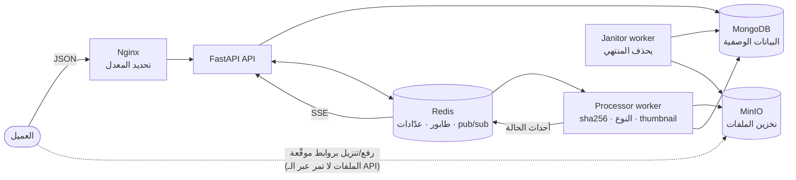

<div align="center" dir="rtl">

# 📦 DropLink

**مشاركة ملفات مؤقتة وآمنة — باكيند FastAPI صغير مبني بأسلوب المشاريع الحقيقية.**

روابط تنتهي · حدّ للتنزيلات · كلمة مرور اختيارية · حالة المعالجة لحظةً بلحظة

[English](README.md) · [العربية](README.ar.md)

</div>

<div dir="rtl">

---

## ما هذا المشروع؟

DropLink يتيح لك رفع ملف والحصول على رابط **ينتهي بالوقت**، أو **بعدد التنزيلات** («يُحرق بعد القراءة»)، ويمكن حمايته **بكلمة مرور**.

المشروع صغير عمداً، لكنه منظَّم كما تُنظَّم الأنظمة الحقيقية: وحدات مقسّمة إلى طبقات، وعمليات خلفية (workers) منفصلة، وطابور رسائل، وأحداث لحظية، وعدّادات ذرّية، ونظام أخطاء مركزي، وDocker وNginx، واختبارات و«مختبرات» (labs) تُثبت أن الأجزاء الصعبة تعمل فعلاً.

> **لمن هو؟** للمبتدئين الذين أنهوا أساسيات FastAPI ويسألون: *«كيف تتركّب القطع معاً في مشروع حقيقي؟»* اقرأه بالترتيب المقترح في [docs/ar/LEARNING_PATH.md](docs/ar/LEARNING_PATH.md).

## كيف يعمل؟



**قصة ملف واحد**

1. `POST /v1/files` ← تحصل على *نموذج رفع موقّع* و`manage_token` سرّي.
2. يرفع العميل الملف **مباشرة إلى MinIO** (الـ API لا يحمل البايتات)، وبحدٍّ أقصى هو الحجم المُعلَن.
3. `POST /v1/files/{id}/complete` ← تدخل المهمة إلى طابور Redis.
4. **الـ processor** (حاوية منفصلة) يحسب بصمة الملف، ويكتشف نوعه الحقيقي، وينشئ صورة مصغّرة للصور، وينشر أحداثاً لحظية.
5. `GET /v1/files/{id}/events` ينقل لك هذه الأحداث (Server-Sent Events).
6. `POST /v1/files/{id}/links` ← رابط بمدة انتهاء، وحدّ تنزيلات، وكلمة مرور اختيارية.
7. من يفتح `/d/{slug}` يُحوَّل إلى **رابط موقّع صالح 60 ثانية**. وسكربت Lua في Redis يعدّ التنزيلات **بشكل ذرّي**.
8. **الـ janitor** يحذف كل ما انتهت صلاحيته.

## تشغيل سريع

المتطلبات: Docker مع Compose بإصدار 2.24 أو أحدث، وPython 3.11+ للمختبرات والاختبارات.

```bash
git clone https://github.com/amralhorimy/droplink.git && cd droplink
cp .env.example .env          # غيّر كلمة مرور MinIO
make up                       # بناء وتشغيل كل شيء
```

افتح **http://localhost:8080/docs** (توثيق تفاعلي للـ API)، ثم جرّب أداة سطر الأوامر:

```bash
pip install -r requirements-dev.txt
echo "hello" > hello.txt
python -m labs.dropctl upload hello.txt --max-downloads 2 --password secret
```

ستطبع رابطاً مثل `http://localhost:8080/d/Ab3dE9xQ`. افتحه مع `?password=secret`، أو:

```bash
curl -i -H "X-Link-Password: secret" http://localhost:8080/d/Ab3dE9xQ   # 302 -> رابط موقّع
```

أوامر أخرى:

| الأمر | ماذا يفعل |
|---|---|
| `make e2e` | القصة الكاملة على النظام العامل (رفع ← SSE ← رابط ← كلمة مرور ← حدّ ← حذف) |
| `make race` | **مختبر:** 200 تنزيل متزامن لرابط حدّه 10 — يجب أن يمر 10 بالضبط |
| `make test` | اختبارات الوحدات والـ API (بدون Docker) |
| `make logs` | متابعة سجلات كل الخدمات |
| `make clean` | إيقاف كل شيء وحذف البيانات |

## ماذا ستجد وتتعلّم

| الموضوع | أين |
|---|---|
| وحدات بطبقات `routes → service → repo` | `app/modules/*` |
| طبقة بنية تحتية، ولكل تقنية `errors.py` خاص | `app/platform/{mongo,redis,minio}` |
| معالجة أخطاء بمسارين (سجلات / عميل) | `app/platform/shared/errors.py`، `handlers.py` |
| نقطة تركيب واحدة بلا متغيرات عامة خفيّة | `app/container.py` |
| رفع مباشر للتخزين مع حدّ للحجم (POST policy) | `app/platform/minio/client.py` |
| عدّادات ذرّية بـ Lua تُصلح نفسها من Mongo | `app/platform/redis/scripts.py` |
| طابور موثوق (BLMOVE + ack + استرجاع بعد الانهيار) | `app/platform/redis/jobs.py`، `workers/processor` |
| Pub/Sub ← SSE دون ضياع أحداث | `app/modules/events/service.py` |
| آلة حالات بتحديث مشروط (compare-and-set) | `app/modules/files/domain.py`، `repo.py` |
| قفل «قائد» لعامل دوري | `workers/janitor/__main__.py` |
| فهارس TTL (Mongo يحذف سجلاته القديمة بنفسه) | `app/platform/mongo/indexes.py` |
| Nginx: تحديد المعدل وSSE وترويسات الأمان | `deploy/nginx/nginx.conf` |
| صورة واحدة بثلاثة أدوار (api / processor / janitor) | `deploy/docker/Dockerfile`، `docker-compose.yml` |
| تجارب تُثبت السلوك | `labs/` |

## هيكل المشروع

```
droplink/
├── app/
│   ├── main.py              # مصنع التطبيق + lifespan
│   ├── container.py         # يربط كل شيء ببعضه
│   ├── deps.py              # dependencies الخاصة بـ FastAPI
│   ├── platform/            # البنية التحتية (بلا قواعد عمل)
│   │   ├── mongo/ redis/ minio/   # لكلٍّ client.py + errors.py
│   │   └── shared/          # الإعدادات، الأخطاء، المعالجات، اللوغ، الأمان
│   └── modules/             # ميزات المشروع
│       ├── files/ links/ downloads/ events/ health/
├── workers/
│   ├── processor/           # مستهلك الطابور: sha256، اكتشاف النوع، thumbnails
│   └── janitor/             # تنظيف دوري
├── labs/                    # CLI، اختبار e2e، تجربة سباق التزامن
├── deploy/                  # Dockerfile، nginx.conf
├── docs/{en,ar}/            # المعمارية، القرارات، مسار التعلّم، مرجع الـ API
└── tests/
```

## التوثيق

| | English | العربية |
|---|---|---|
| المعمارية | [docs/en/ARCHITECTURE.md](docs/en/ARCHITECTURE.md) | [docs/ar/ARCHITECTURE.md](docs/ar/ARCHITECTURE.md) |
| قرارات التصميم (ال«لماذا») | [docs/en/DECISIONS.md](docs/en/DECISIONS.md) | [docs/ar/DECISIONS.md](docs/ar/DECISIONS.md) |
| مسار التعلّم | [docs/en/LEARNING_PATH.md](docs/en/LEARNING_PATH.md) | [docs/ar/LEARNING_PATH.md](docs/ar/LEARNING_PATH.md) |
| مرجع الـ API | [docs/en/API.md](docs/en/API.md) | [docs/ar/API.md](docs/ar/API.md) |

## حدود صريحة

هذا مشروع تعليمي: لا توجد حسابات مستخدمين (توكن سرّي يملك كل ملف)، والـ rate limiter من نوع النافذة الثابتة، ومعالج واحد لكل `WORKER_ID`. يشرح [DECISIONS.md](docs/ar/DECISIONS.md) كل مفاضلة وما الذي ستغيّره في الإنتاج.

## المساهمة والأمان

انظر [CONTRIBUTING.md](CONTRIBUTING.md) و[SECURITY.md](SECURITY.md). الرخصة [MIT](LICENSE).

---

<div align="center">بناء <b>amralhorimy</b> · <a href="https://github.com/amralhorimy">GitHub</a></div>

</div>
