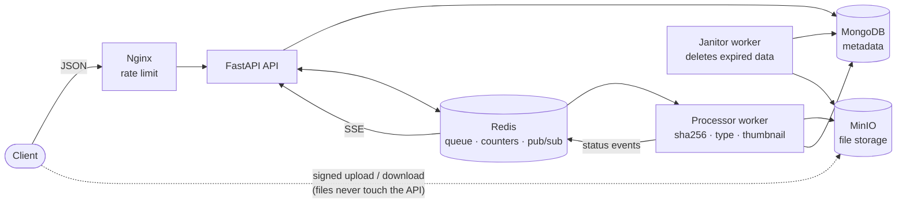

<div align="center">

# 📦 DropLink

**Temporary, secure file sharing — a small FastAPI backend built like a real one.**

Expiring links · download limits · optional password · live processing status

[English](README.md) · [العربية](README.ar.md)

  

</div>

---

## What is this?

DropLink lets you upload a file and get a link that **expires by time**, **by number of downloads** ("burn after reading"), and can be **password protected**.

It is deliberately small, but it is organised the way production backends are: layered modules, separate worker processes, a message queue, real-time events, atomic counters, a central error system, Docker + Nginx, tests and "labs" that prove the hard parts work.

> **Who is it for?** Beginners who finished the FastAPI basics and ask *"how do the pieces fit together in a real project?"* — read it in the order suggested in [docs/en/LEARNING_PATH.md](docs/en/LEARNING_PATH.md).

## How it works



**The story of one file**

1. `POST /v1/files` → you get a *signed upload form* + a secret `manage_token`.
2. Your client uploads **directly to MinIO** (the API never carries the bytes), capped to the declared size.
3. `POST /v1/files/{id}/complete` → the job goes onto a Redis queue.
4. The **processor** (a separate container) hashes the file, detects its real type, makes a thumbnail for images, and publishes live events.
5. `GET /v1/files/{id}/events` streams those events to you (Server-Sent Events).
6. `POST /v1/files/{id}/links` → a link with an expiry, a download limit, optionally a password.
7. Anyone opening `/d/{slug}` is redirected to a **60-second signed URL**. A Lua script in Redis counts downloads **atomically**.
8. The **janitor** deletes whatever has expired.

## Quick start

Requirements: Docker with Compose ≥ 2.24, and Python 3.11+ for the labs/tests.

```bash
git clone https://github.com/amralhorimy/droplink.git && cd droplink
cp .env.example .env          # change the MinIO password
make up                       # build + start everything
```

Open **http://localhost:8080/docs** (interactive API docs), then try the CLI:

```bash
pip install -r requirements-dev.txt
echo "hello" > hello.txt
python -m labs.dropctl upload hello.txt --max-downloads 2 --password secret
```

It prints a link such as `http://localhost:8080/d/Ab3dE9xQ`. Open it with `?password=secret`, or:

```bash
curl -i -H "X-Link-Password: secret" http://localhost:8080/d/Ab3dE9xQ   # 302 -> signed URL
```

More commands:

| Command | What it does |
|---|---|
| `make e2e` | Full story against the running stack (upload → SSE → link → password → limit → delete) |
| `make race` | **Lab:** 200 simultaneous downloads of a "max 10" link — exactly 10 must pass |
| `make test` | Unit + API tests (no Docker needed) |
| `make logs` | Follow all service logs |
| `make clean` | Stop and delete all data |

## What you will find (and learn)

| Topic | Where |
|---|---|
| Layered modules `routes → service → repo` | `app/modules/*` |
| Infrastructure wrappers, each with its own `errors.py` | `app/platform/{mongo,redis,minio}` |
| Two-path error handling (logs vs client) | `app/platform/shared/errors.py`, `handlers.py` |
| Composition root, no hidden globals | `app/container.py` |
| Direct-to-storage uploads with size limits (POST policy) | `app/platform/minio/client.py` |
| Atomic counters with Lua, self-healing from Mongo | `app/platform/redis/scripts.py` |
| Reliable queue (BLMOVE + ack + crash recovery) | `app/platform/redis/jobs.py`, `workers/processor` |
| Pub/Sub → Server-Sent Events without missing events | `app/modules/events/service.py` |
| Compare-and-set state machine | `app/modules/files/domain.py`, `repo.py` |
| Leader lock for a periodic worker | `workers/janitor/__main__.py` |
| TTL indexes (Mongo deletes its own old records) | `app/platform/mongo/indexes.py` |
| Nginx: rate limits, SSE, security headers | `deploy/nginx/nginx.conf` |
| One image, three roles (api / processor / janitor) | `deploy/docker/Dockerfile`, `docker-compose.yml` |
| Experiments that prove behaviour | `labs/` |

## Project layout

```
droplink/
├── app/
│   ├── main.py              # app factory + lifespan
│   ├── container.py         # wires everything together
│   ├── deps.py              # FastAPI dependencies
│   ├── platform/            # infrastructure (no business rules)
│   │   ├── mongo/ redis/ minio/   # client.py + errors.py each
│   │   └── shared/          # config, errors, handlers, logging, security
│   └── modules/             # business features
│       ├── files/ links/ downloads/ events/ health/
├── workers/
│   ├── processor/           # queue consumer: sha256, type sniffing, thumbnails
│   └── janitor/             # periodic cleanup
├── labs/                    # CLI, e2e smoke test, race-condition experiment
├── deploy/                  # Dockerfile, nginx.conf
├── docs/{en,ar}/            # architecture, decisions, learning path, API
└── tests/
```

## Documentation

| | English | العربية |
|---|---|---|
| Architecture | [docs/en/ARCHITECTURE.md](docs/en/ARCHITECTURE.md) | [docs/ar/ARCHITECTURE.md](docs/ar/ARCHITECTURE.md) |
| Design decisions (the *why*) | [docs/en/DECISIONS.md](docs/en/DECISIONS.md) | [docs/ar/DECISIONS.md](docs/ar/DECISIONS.md) |
| Learning path | [docs/en/LEARNING_PATH.md](docs/en/LEARNING_PATH.md) | [docs/ar/LEARNING_PATH.md](docs/ar/LEARNING_PATH.md) |
| API reference | [docs/en/API.md](docs/en/API.md) | [docs/ar/API.md](docs/ar/API.md) |

## Honest limits

This is a teaching project. It has no user accounts (a secret token owns each file), uses a fixed-window rate limiter, and a single processor per `WORKER_ID`. [DECISIONS.md](docs/en/DECISIONS.md) explains each trade-off and what you would change for production.

## Help DropLink reach more developers

If this project helps you understand real-world backend engineering, consider:

- **Star** the repository to make it easier for other developers to discover.
- **Share** it with a developer learning FastAPI, Redis, MongoDB, or Docker.
- **Try a lab** and open an issue if you find a reproducible bug or a useful improvement.
- **Contribute** documentation, tests, examples, or a focused feature.

The best way to evaluate the project is to run it locally and explore the architecture—not just look at the folder names.

## Contributing & security

See [CONTRIBUTING.md](CONTRIBUTING.md) and [SECURITY.md](SECURITY.md). Licensed under [MIT](LICENSE).

---

<div align="center">Built by <b>amralhorimy</b> · <a href="https://github.com/amralhorimy">GitHub</a></div>
