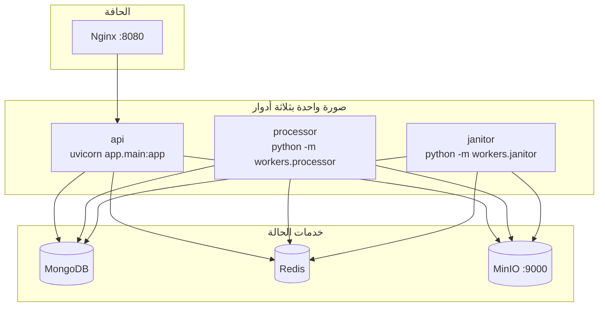
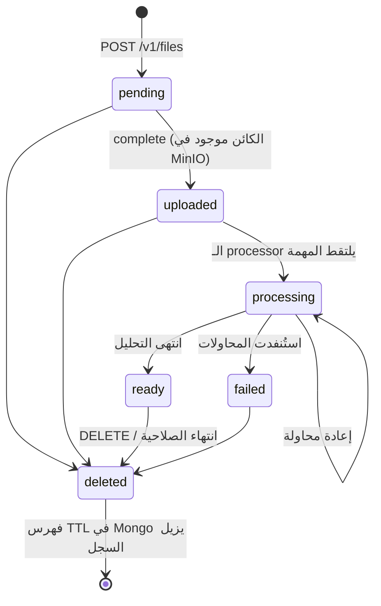
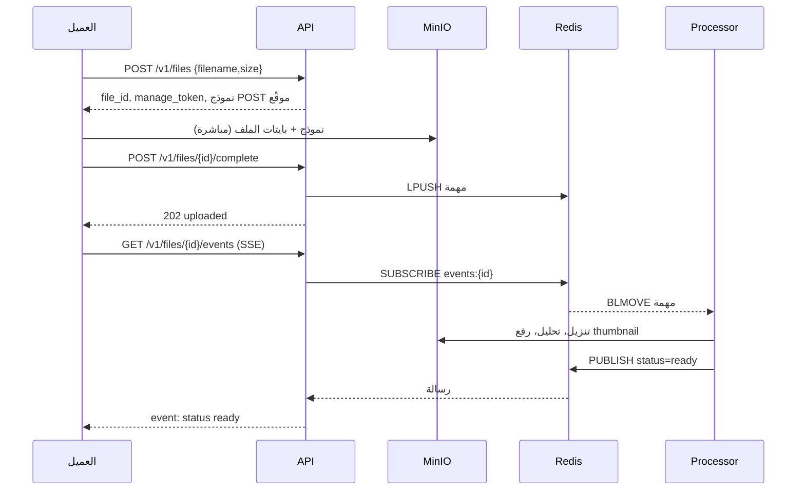
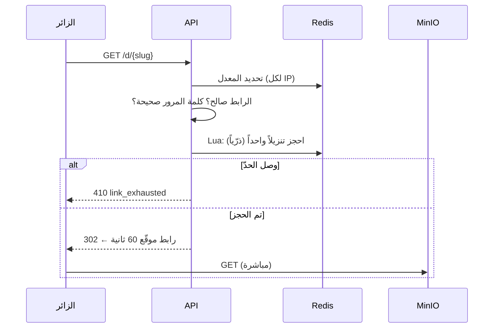

<div dir="rtl">

# المعمارية

[English](../en/ARCHITECTURE.md) · [العودة إلى README](../../README.ar.md)

## 1. الصورة الكبيرة



لكل خدمة حالة **وظيفة واحدة**:

| الخدمة | ماذا تحفظ | لماذا اختيرت لذلك |
|---|---|---|
| MongoDB | البيانات الوصفية للملفات والروابط | مستندات مرنة، وفهارس TTL تحذف السجلات القديمة وحدها |
| Redis | طابور المهام، عدّادات التنزيل، تحديد المعدل، الأحداث اللحظية | عمليات ذرّية، وpub/sub، وسرعة |
| MinIO | بايتات الملفات | متوافق مع S3، والروابط الموقّعة تتيح للعميل مخاطبة التخزين مباشرة |

## 2. طبقات الكود

```
طلب HTTP
   │
   ▼
routes.py      يقرأ المدخلات ويتحقق منها، يستدعي دالة واحدة من service، ويصوغ الرد
   │
   ▼
service.py     قواعد العمل («الرابط لا يعيش أطول من ملفه»)
   │
   ▼
repo.py        استعلامات قاعدة البيانات فقط          platform/*  يتحدث مع العالم الخارجي
```

قواعد تُبقي المشروع نظيفاً:

1. الـ `routes` لا تلمس قاعدة بيانات. والـ `repo` لا يرفع أخطاء HTTP. والـ `service` لا يستورد FastAPI.
2. الـ `platform/` لا يعرف شيئاً عن الملفات أو الروابط؛ والـ `modules/` لا تستورد درايفر (`motor` أو `redis` أو `minio`) مباشرة إلا عبر `platform/`.
3. كل شيء يُربط في **مكان واحد**: `app/container.py`. لا clients عامة مخفيّة.

## 3. خريطة المجلدات

| المسار | المسؤولية |
|---|---|
| `app/main.py` | إنشاء التطبيق، تشغيل/إيقاف البنية التحتية (lifespan)، ربط الـ routers |
| `app/container.py` | نقطة التركيب: بناء الـ repos والـ services |
| `app/deps.py` | dependencies: الوصول للـ container، ترويسة التوكن، تحديد المعدل لكل مسار |
| `app/platform/infra.py` | `Infra`: يتصل بـ Mongo/Redis/MinIO مرة واحدة؛ يستخدمه الـ API **والـ workers** |
| `app/platform/<tech>/errors.py` | يترجم استثناءات الدرايفر إلى أخطائنا (`with translate_mongo_errors("op"):`) |
| `app/platform/shared/` | الإعدادات، فئات الأخطاء، المعالجات، اللوغ، الـ middleware، أدوات الأمان |
| `app/modules/files` | تسجيل الرفع، إكماله، آلة الحالات، الحذف |
| `app/modules/links` | قواعد الانتهاء وحدّ التنزيل وكلمة المرور |
| `app/modules/downloads` | المسار الساخن: الحدّ ← كلمة المرور ← الحجز الذرّي ← التحويل الموقّع |
| `app/modules/events` | Redis pub/sub ← Server-Sent Events |
| `workers/processor` | استهلاك المهام: بصمة، اكتشاف النوع، thumbnail، نشر الحالة |
| `workers/janitor` | حذف الملفات المنتهية والرفع المعلّق وإعادة طرح الرفع العالق |

## 4. آلة حالات الملف



كل انتقال هو **تحديث مشروط ذرّي** في Mongo (`find_one_and_update` مقيَّد بالحالات السابقة المسموحة). نداءان متزامنان لـ `complete`، أو مهمة مكرّرة، لا يمكنهما إفساد ملف: واحد ينجح والآخر يُرفض أو يُتجاوز.

## 5. تسلسل: الرفع ← الحالة اللحظية



نقطة SSE **تشترك أولاً ثم تقرأ الحالة الحالية** من Mongo، فلا يمكن لأي حدث أن يسقط بين الخطوتين.

## 6. تسلسل: التنزيل



## 7. معالجة الأخطاء (مساران)

```
raise Conflict("row locked on files/42", public_message="Already done.")
        │
        ├── المسار 1 ← السجلات : المستوى، code، request_id، السياق كاملاً، stack للـ 5xx
        └── المسار 2 ← العميل  : {"error": {"code","message","request_id"}}   (لا شيء داخلي)
```

* فئات `AppError` تحمل `status_code` و`code` ثابتاً مقروءاً آلياً و`public_message` آمنة.
* كل مجلد بنية تحتية يترجم استثناءات درايفره (`PyMongoError`، `RedisError`، `S3Error`) إلى أخطاء `…Unavailable`، فيظهر انقطاع Mongo كـ `503 database_unavailable` نظيف لا كـ stack trace.
* أي استثناء غير معروف يصير `500 internal_error` عاماً — والسبب الحقيقي في السجلات فقط، مربوطاً بـ `request_id`.

## 8. ميزات الموثوقية

| المشكلة | الحل |
|---|---|
| انهيار العامل أثناء مهمة | `BLMOVE` يحتفظ بنسخة في قائمة خاصة بالعامل؛ تُسترجع عند إعادة التشغيل |
| ضياع المهمة لأن Redis تعثّر بعد تأكيد الرفع | الـ janitor يعيد طرح الملفات العالقة في `uploaded` |
| تشغيل أكثر من janitor | قفل قائد بـ Redis `SET NX EX` |
| فقدان Redis لعدّاد | يُعاد زرعه من عدد التنزيلات المحفوظ في Mongo |
| لم يُكمل أحد الرفع | الـ janitor يحذف ملفات `pending` بعد ساعة |
| انقطاع العميل عن SSE | البث يكتشف ذلك ويلغي الاشتراك (لا اتصالات متسرّبة) |
| بدء الحاويات بترتيب خاطئ | healthchecks + حلقة إعادة محاولة عند الإقلاع |

</div>
