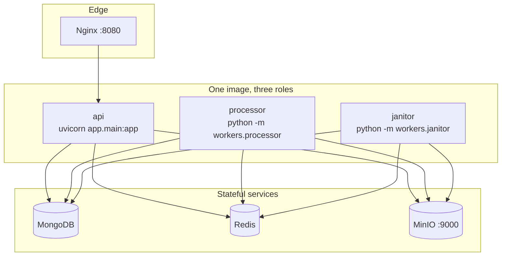
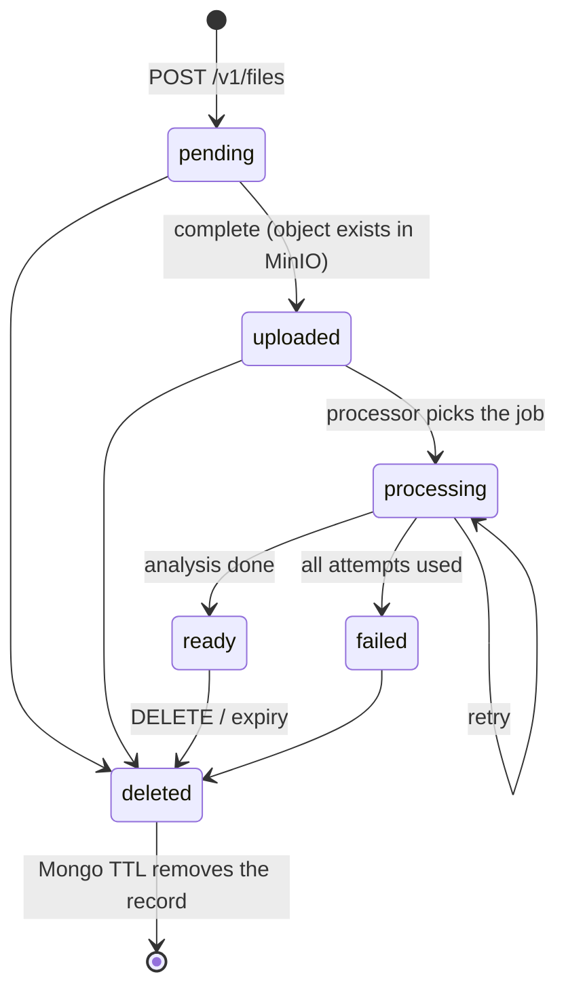
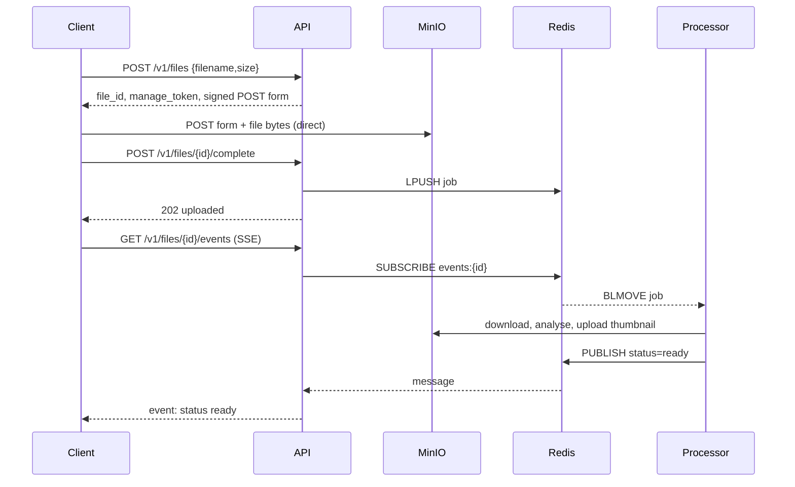
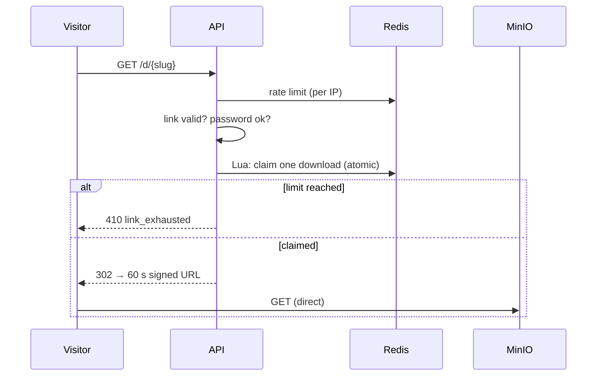

# Architecture

[العربية](../ar/ARCHITECTURE.md) · [Back to README](../../README.md)

## 1. The big picture



Each stateful service has **one job**:

| Service | Holds | Why it was chosen for that |
|---|---|---|
| MongoDB | file + link metadata | flexible documents, TTL indexes delete old records by themselves |
| Redis | job queue, download counters, rate limits, live events | atomic operations, pub/sub, speed |
| MinIO | the file bytes | S3-compatible, signed URLs let clients talk to storage directly |

## 2. Code layers

```
HTTP request
   │
   ▼
routes.py      parse/validate input, call ONE service method, shape the response
   │
   ▼
service.py     business rules ("a link can never outlive its file")
   │
   ▼
repo.py        database queries only             platform/*  talks to the outside world
```

Rules that keep it clean:

1. `routes` never touch a database. `repo` never raises HTTP errors. `service` never imports FastAPI.
2. `platform/` knows **nothing** about files or links; `modules/` never import a driver (`motor`, `redis`, `minio`) directly except through `platform/`.
3. Everything is wired in **one place**, `app/container.py`. No hidden global clients.

## 3. Folder map

| Path | Responsibility |
|---|---|
| `app/main.py` | create the app, start/stop infrastructure (lifespan), mount routers |
| `app/container.py` | composition root: build repos and services |
| `app/deps.py` | FastAPI dependencies: container access, manage-token header, per-route rate limit |
| `app/platform/infra.py` | `Infra`: connects Mongo/Redis/MinIO once; used by API **and** workers |
| `app/platform/<tech>/errors.py` | translate driver exceptions into our errors (`with translate_mongo_errors("op"):`) |
| `app/platform/shared/` | config, error classes, handlers, logging, middleware, security helpers |
| `app/modules/files` | upload registration, completion, state machine, deletion |
| `app/modules/links` | expiry / download limit / password rules |
| `app/modules/downloads` | the hot path: limit → password → atomic claim → signed redirect |
| `app/modules/events` | Redis pub/sub → Server-Sent Events |
| `workers/processor` | consume jobs: hash, sniff, thumbnail, publish status |
| `workers/janitor` | delete expired files, stale uploads, re-queue stuck uploads |

## 4. The file state machine



Every transition is an **atomic compare-and-set** in Mongo (`find_one_and_update` filtered on the allowed previous states). Two concurrent `complete` calls, or a duplicated job, cannot corrupt a file: one wins, the other is refused or skipped.

## 5. Sequence: upload → live status



The SSE endpoint **subscribes first, then reads the current status** from Mongo, so no event can slip between the two steps.

## 6. Sequence: a download



## 7. Error handling (two paths)

```
raise Conflict("row locked on files/42", public_message="Already done.")
        │
        ├── path 1 → LOGS   : level, code, request_id, full context, stack for 5xx
        └── path 2 → CLIENT : {"error": {"code","message","request_id"}}   (nothing internal)
```

* `AppError` subclasses carry `status_code`, a stable machine `code`, and a safe `public_message`.
* Each infrastructure folder translates its driver's exceptions (`PyMongoError`, `RedisError`, `S3Error`) into `…Unavailable` errors, so a Mongo outage looks like a clean `503 database_unavailable`, never a stack trace.
* Unknown exceptions become a generic `500 internal_error` — the real cause is only in the logs, tied to the `request_id`.

## 8. Reliability features

| Problem | Solution |
|---|---|
| Worker crashes mid-job | `BLMOVE` keeps a copy in a per-worker list; recovered on restart |
| Job lost because Redis blipped after the upload was confirmed | Janitor re-queues files stuck in `uploaded` |
| Two janitors running | Redis `SET NX EX` leader lock |
| Redis loses a counter | Counter re-seeded from Mongo's persisted download count |
| Nobody completes an upload | Janitor deletes `pending` files after an hour |
| Client disconnects from SSE | Stream detects it and unsubscribes (no leaked connections) |
| Containers start in the wrong order | Healthchecks + start-up retry loop |
